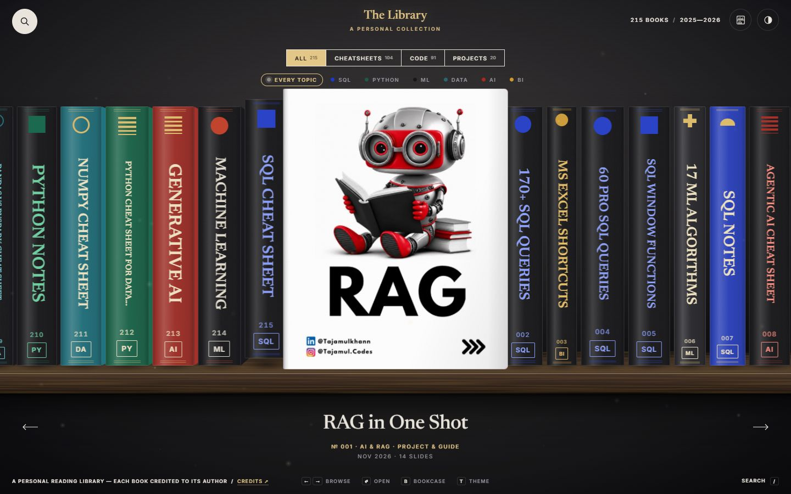
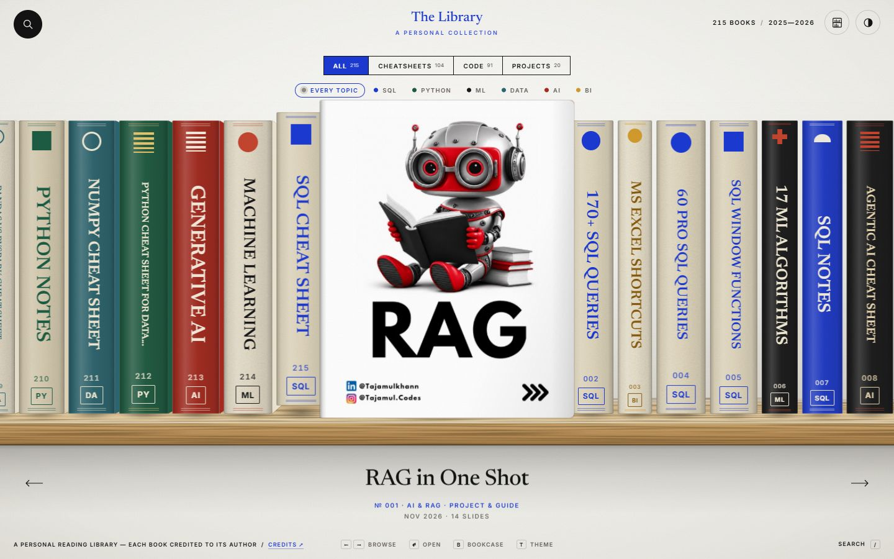
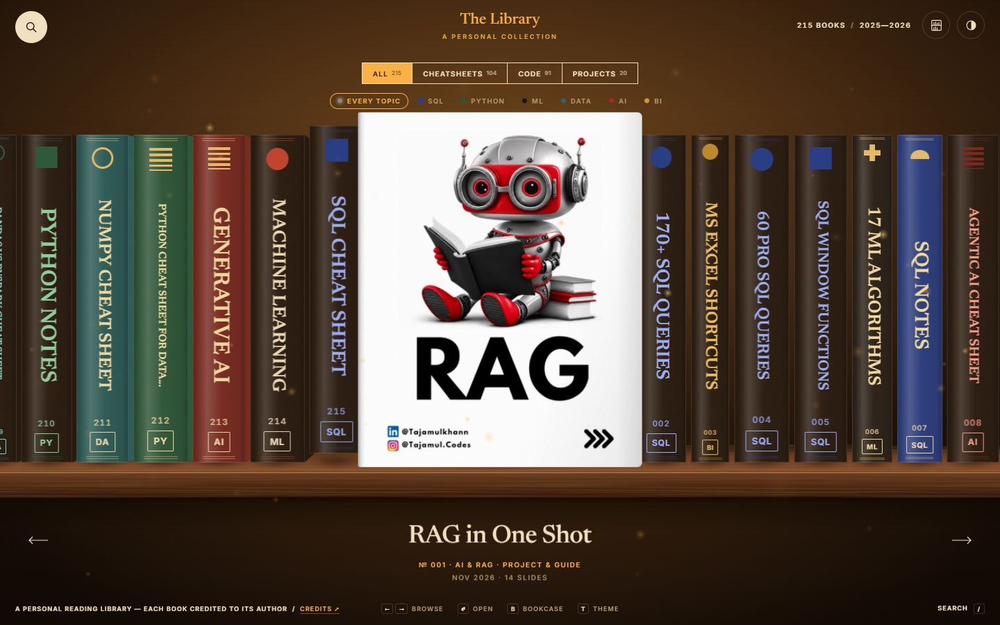
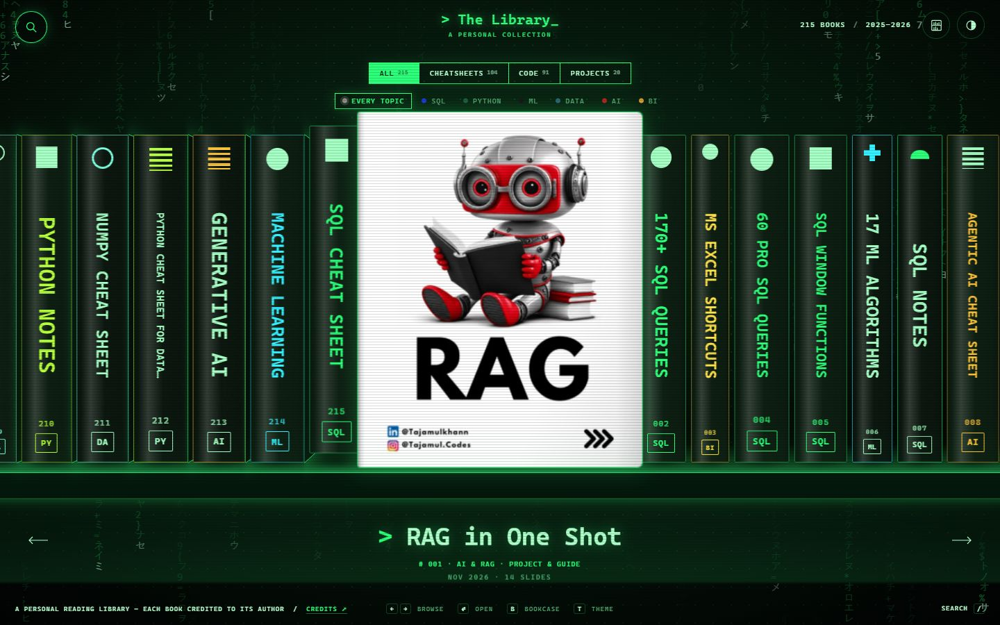
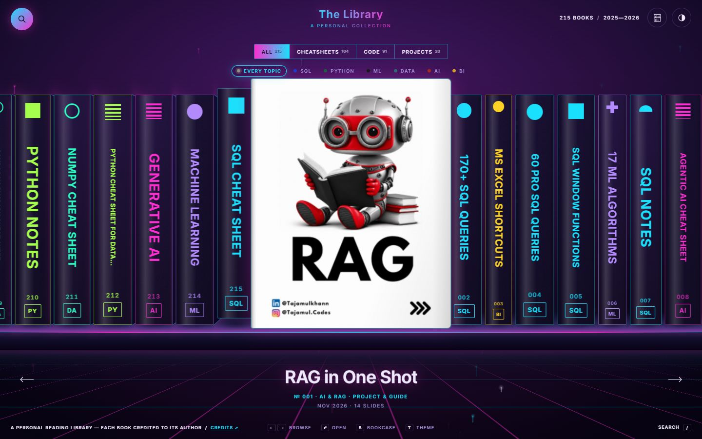
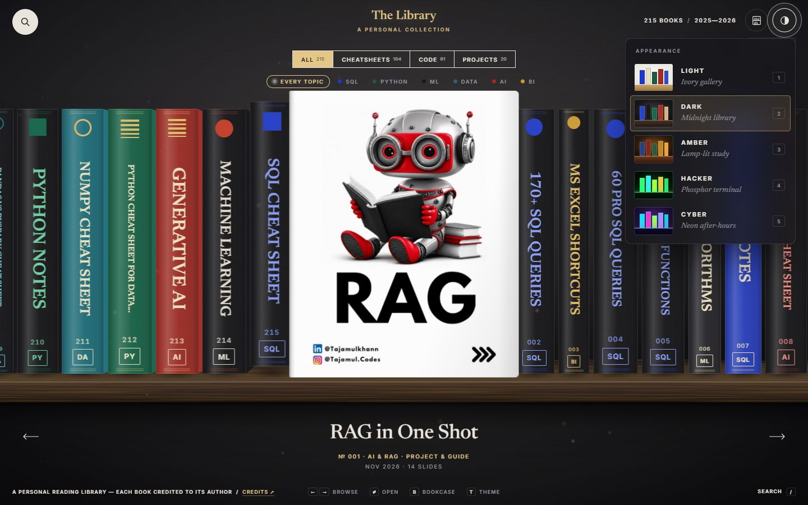
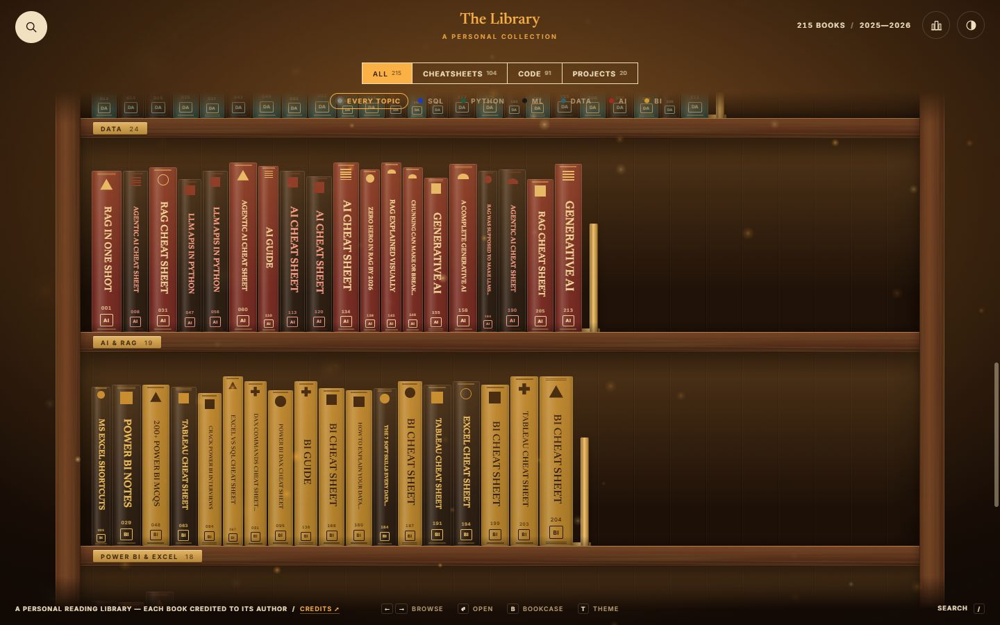
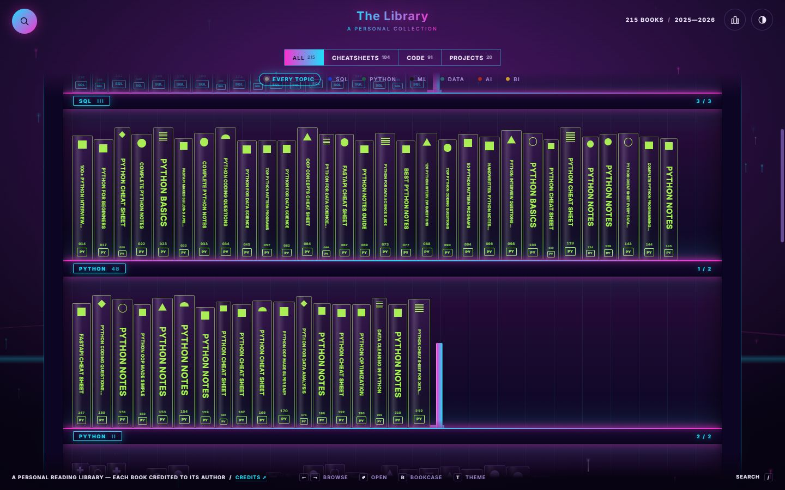
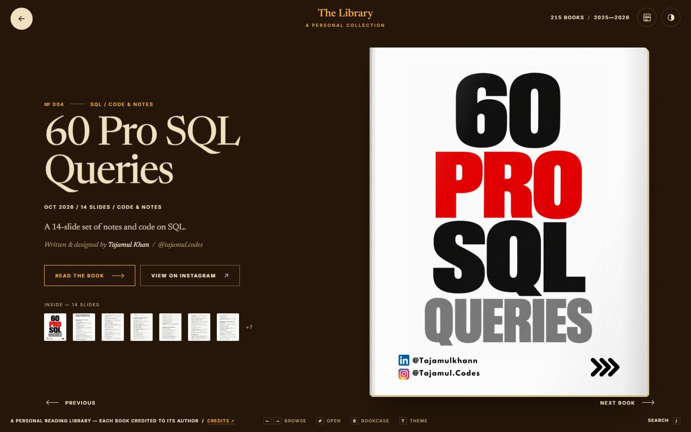

# The Library

A personal reading library: a motion-rich **3D bookshelf**, and a full wooden **bookcase**, of **215 cheat sheets, code notes and guides** (1,737 slides) with a book page, a slide reader, search and **five themes**.

**Live site:** https://rahul9994.github.io/my-library/



## What is in it

- **Two ways to browse.** The *carousel* is an endless 3D shelf: spines turn into covers as you move along it. The *bookcase* (press `B`) shows every book standing neatly on wooden shelves, grouped by topic, with brass shelf plates, bookends and a hover card that reveals the cover. Open a book and it is pulled off its shelf, turns from spine to cover and lands on its page; close it and it slides back into the gap it left.
- **Five themes** (press `T`): Light, Dark, Amber, Hacker and Cyber. A theme re-skins the wall, the shelf material, every spine, the lighting, the type and the details. The picker shows live miniatures, and switching plays a reveal (a circle, a scan line or a neon sweep). Your choice is remembered; until you choose, the site follows your system's light or dark setting.
- **A book page**, a **slide reader** (swipe, tap to zoom, drag to pan, thumbnails) and instant **search** (`/` or `Ctrl`+`K`).
- **Proper history.** The address bar always matches the view, so links to a book (`#/<id>`) or a slide (`#/<id>/read/3`) work, and Back, Forward, `Esc` and the round button all unwind one level at a time.
- **Built for everyone.** Keyboard-first, `prefers-reduced-motion` respected, UI text meets WCAG AA contrast in every theme, works on phones and tablets, and works offline straight from `index.html`.

| Light | Dark | Amber |
| --- | --- | --- |
|  |  |  |

| Hacker | Cyber | Theme picker |
| --- | --- | --- |
|  |  |  |

| Bookcase (Amber) | Bookcase (Cyber) | A book page |
| --- | --- | --- |
|  |  |  |

## Credits and takedowns

**Every book on this site, including all slides, titles and descriptions, is the work of [Tajamul Khan](https://www.instagram.com/tajamul.codes/) ([@tajamul.codes](https://www.instagram.com/tajamul.codes/)).**
They were collected from his public Instagram posts as a personal reading library. Each book's page on the site shows his name and links back to the original post.

- I do not claim ownership of any of the slides. They are **not licensed** for reuse or redistribution - all rights remain with the author.
- Please follow [@tajamul.codes](https://www.instagram.com/tajamul.codes/) for the originals and for the extra notes and resources he shares.
- **If you are the author or a rights holder** and want something credited differently, changed or removed, please [open an issue](https://github.com/Rahul9994/my-library/issues) and it will be taken down promptly.

## Built with

- [GSAP](https://gsap.com/) for animation (GreenSock standard licence)
- [Newsreader](https://fonts.google.com/specimen/Newsreader) (Production Type) and [Inter](https://rsms.me/inter/) (Rasmus Andersson), both under the SIL Open Font License
- Python + [Pillow](https://python-pillow.org/) to build the aligned 4:5 thumbnails and the catalogue
- Site design and code by [Rahul9994](https://github.com/Rahul9994), built with help from Claude (Anthropic)

No framework, no bundler and no other dependencies: plain HTML, CSS and JavaScript.

## Using it

Open `index.html` (works offline, no server needed) or visit the live site.

| Key | Action |
| --- | --- |
| `←` `→`, drag, wheel | move along the shelf |
| `Enter` / click the lifted cover | open a book |
| `B` | switch between the carousel and the bookcase |
| `T` / `Shift`+`T` | next / previous theme (`1`-`5` while the picker is open) |
| `/` or `Ctrl`+`K` | search |
| `Esc` or the browser's Back button | go back one level |

In the bookcase the arrow keys move between books and shelves, and `Enter` opens the focused book. Add `?theme=cyber` (or `dark`, `amber`, `hacker`, `light`) and `?view=case` to a link to open it in a particular theme or view.

## Folders

| Folder | What is in it |
| --- | --- |
| `tajamul.codes_cheatsheets/` | 104 cheat sheets (one folder per book, slides inside) |
| `tajamul.codes_code_posts/` | 91 SQL / Python code posts and notes |
| `tajamul.codes_projects_RAG_PowerBI/` | 20 projects, RAG and Power BI posts |
| `_site/` | the website itself (see below) |

Inside `_site/`:

| Path | Purpose |
| --- | --- |
| `css/style.css` | header, filters, book page, reader, search - everything colour or font related comes from tokens |
| `css/shelf.css` | the wall, the plank, the spines, the 3D shelf and the bookcase |
| `css/themes.css` | the five themes as design tokens, plus a few character rules (scan lines, neon, terminal prompt) |
| `js/app.js` | the engine: endless shelf, bookcase, page, reader, search, history |
| `js/theme.js` | theme manager and picker |
| `js/fx.js` | ambient atmosphere (dust, embers, glyph rain, sparks) |
| `js/data.js` | the catalogue, generated by `tools/build_library.py` |
| `thumbs/`, `covers/`, `fonts/`, `vendor/`, `preview/`, `tools/` | thumbnails, covers, fonts, GSAP, screenshots and the build script |

### Adding a theme

A theme is a block of CSS custom properties in `css/themes.css` (wall, plank, ink, accent, the eight topic colours and a few more). Three small things wire it in:

1. add its name to one of the two spine recipes at the bottom of the token blocks in `css/themes.css` (the "solid" recipe used by Dark and Amber, or the "neon" recipe used by Hacker and Cyber);
2. add an entry to the `THEMES` list in `js/theme.js` (name, one-line description, browser colour, favicon colours);
3. add its name to the small inline script at the top of `index.html`, which applies the saved theme before first paint.

The picker and its live miniature are generated from the same tokens, so they follow automatically.

### Why it stays smooth

- The endless shelf keeps a small pool of about forty book elements and binds them to books as they scroll into view, instead of one element per book.
- The view you are not looking at is locked with `content-visibility`, so a theme change only restyles what is on screen. The bookcase renders shelves lazily and unlocks the rest while idle.
- Spine typography is sized in `em` from a single custom property, which keeps style recalculation cheap with hundreds of spines.
- Heavy first paints happen at the click rather than in the middle of an animation, and theme changes inside the bookcase hide the repaint behind a curtain.

## Adding more books (any author, any subject)

1. Make a new folder next to `index.html`, e.g. `My Books`, with one folder per book and the pages as `01.jpg`, `02.jpg`, ... (`.png` / `.webp` also work):

   ```
   My Books/The Art of Calm/01.jpg
   My Books/The Art of Calm/02.jpg
   ```

2. Run `python _site/tools/build_library.py`. It rebuilds the thumbnails and the catalogue; the filter chips appear on their own.

Optional details (plain JSON, every field optional):

`My Books/The Art of Calm/book.json`

```json
{
  "title": "The Art of Calm",
  "author": "Jane Doe",
  "handle": "@janedoe",
  "source": "https://example.com/calm",
  "topic": "other",
  "description": "A short guide to slowing down.",
  "date": "2026-05-02"
}
```

`topic` is one of `sql`, `python`, `ml`, `ai`, `bi`, `data`, `career`, `other`.

`My Books/collection.json` (applies to every book in the folder)

```json
{ "type": "book", "chip": "Books", "label": "Book", "author": "Jane Doe" }
```

Without a `book.json` the title comes from the folder name and the date from the folder name (`2026-05-02_the-art-of-calm`) or its modified time. Always credit the author of anything you add.
